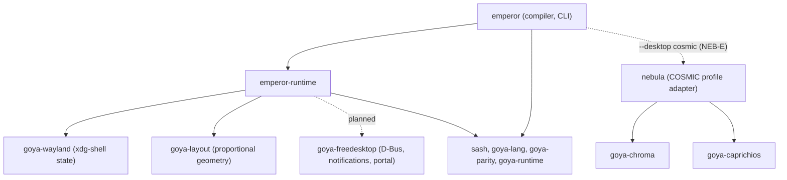

# Nebula programme status

Programme GY-NEB-001, revision 0.1.0, recorded 19 November 2026. Base commit `6193d310603fa2668d8bde6ac3159cdec80f2ef9` on `nebula/integration`. This directory is the repository copy of the Nebula contract. It does not certify any NEB milestone, it does not certify Emperor milestone EMP-M1, and it does not grant a production designation.

Nebula is the COSMIC desktop profile and qualification lane of Emperor. It is not a second compiler. The qualification host is one Pop!_OS 24.04 COSMIC workstation. Release authority is executable evidence, under the rules in [../emperor/evidence.md](../emperor/evidence.md). A protocol listing, a theme read, or this document is not that evidence.

## Binding decisions

1. Nebula is a desktop profile of Emperor, selected with `emperor build --desktop cosmic`, plus the adapter crate `crates/nebula`. There is no Nebula dialect, no Nebula lowering, and no Nebula code generator. The shared oracle in [../emperor/contracts/gy-cross-parity-1.md](../emperor/contracts/gy-cross-parity-1.md) is unchanged.
2. Generic work lives upstream. xdg-shell state belongs to `goya-wayland`. Proportional geometry belongs to `goya-layout`. Freedesktop D-Bus, notifications and portals belong to `goya-freedesktop`. ELF output, rendering, packaging and signing belong to Emperor. NEB-005, NEB-006, and most of NEB-002 and NEB-004 are therefore Emperor or shared deliverables that Nebula only qualifies on COSMIC.
3. Nebula narrows the order of qualification. It does not narrow Emperor's release gate. The four-compositor matrix in GY-EMP-001 §4.3 still governs Emperor release.
4. COSMIC compositor optimisations are dropped until a measurement motivates one.
5. Xwayland on the COSMIC session never counts as COSMIC qualification.
6. The running App keeps capability `filesystem: none`. The COSMIC theme is resolved at build time and baked into the build. Live theme following is Unmet.
7. COSMIC-private protocols (`zcosmic_*`, `cosmic_*`) are observed and not used by applications.

## Architecture

Arrows point from a crate to the crate it depends on. Solid arrows are dependencies in the `Cargo.toml` files at the base commit. Dashed arrows are the planned `--desktop cosmic` path and the planned consumers of the wave-1 shared crates. They are not present at the base commit.

Nebula depends on shared crates. No shared crate depends on Nebula. `goya-freedesktop` has no dependencies and no COSMIC-specific code (`crates/goya-freedesktop/README.md`).

## What wave 1 produced

- `crates/goya-wayland`: `xdg_wm_base` bound at `min(advertised, 7)`, with `ToplevelState` and `WmCapabilities` exposed additively. One live observation on COSMIC is recorded in the module documentation at `crates/goya-wayland/src/lib.rs` (lines 104 to 111). No state transition was observed.
- `crates/goya-layout/src/proportional.rs`: opt-in integer proportional placement with an exact inverse. Nothing calls it yet.
- `crates/goya-freedesktop`: a std-only session D-Bus client, notifications, and portal appearance. One live run on COSMIC is recorded in `crates/goya-freedesktop/README.md`. Signals are not subscribed.
- `crates/nebula`: session detection, installed compositor version, the protocol profile, the COSMIC theme reader and Chroma mapping, and the Caprichio selection. One probe record is `evidence/nebula/probe-2026-11-19.json`. No window was opened by that probe.

Stream NEB-E (`emperor build --desktop cosmic`, theme baking, the cosmic resize policy, compositor identification in smoke output, and a live NEB-001 record) is in progress. Its results are not recorded here. Rows that need them say Pending NEB-E evidence.

No NEB milestone is Measured. EMP-M1-07, the compositor matrix, stays Blocked.

## Where the rest of the contract lives

- Programme specification: [GY-NEB-001.md](GY-NEB-001.md)
- Gaps: [gap-ledger.md](gap-ledger.md)
- COSMIC protocol profile, human-readable: [protocol-profile.md](protocol-profile.md). The authoritative table is `COSMIC_PROFILE` in `crates/nebula/src/protocols.rs`.
- Emperor contract, which Nebula specialises: [../emperor/GY-EMP-001.md](../emperor/GY-EMP-001.md)
- Emperor gaps that Nebula helps close: [../emperor/gap-ledger.md](../emperor/gap-ledger.md)
- Evidence rules: [../emperor/evidence.md](../emperor/evidence.md). Nebula records live under `evidence/nebula/`.
- Crate documentation: `crates/nebula/README.md`, `crates/goya-freedesktop/README.md`, the module header of `crates/goya-wayland/src/toplevel_state.rs`, and the module header of `crates/goya-layout/src/proportional.rs`.

The governing rule is Emperor's: compile first, prove correctness second, optimise under measurement third, and claim superiority only after comparative evidence. Nothing in this directory claims that Nebula is faster, more native, or more complete than any other COSMIC application.
