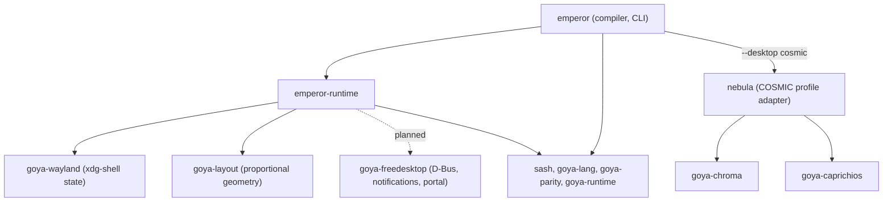

# Nebula programme status

Programme GY-NEB-001, revision 0.1.0, recorded 19 November 2026. Base commit `6193d310603fa2668d8bde6ac3159cdec80f2ef9` on `nebula/integration`. This directory is the repository copy of the Nebula contract. It does not certify any NEB milestone, it does not certify Emperor milestone EMP-M1, and it does not grant a production designation.

Nebula is the COSMIC desktop profile and qualification lane of Emperor. It is not a second compiler. The qualification host is one Pop!_OS 24.04 COSMIC workstation. Release authority is executable evidence, under the rules in [../emperor/evidence.md](../emperor/evidence.md). A protocol listing, a theme read, or this document is not that evidence.

## Binding decisions

1. Nebula is a desktop profile of Emperor, selected with `emperor build --desktop cosmic`, plus the adapter crate `crates/nebula`. There is no Nebula dialect, no Nebula lowering, and no Nebula code generator. The shared oracle in [../emperor/contracts/gy-cross-parity-1.md](../emperor/contracts/gy-cross-parity-1.md) is unchanged.
2. Generic work lives upstream. xdg-shell state belongs to `goya-wayland`. Proportional geometry belongs to `goya-layout`. Freedesktop D-Bus, notifications and portals belong to `goya-freedesktop`. ELF output, rendering, packaging and signing belong to Emperor. NEB-005, NEB-006, and most of NEB-002 and NEB-004 are therefore Emperor or shared deliverables that Nebula only qualifies on COSMIC.
3. Nebula narrows the order of qualification. It does not narrow Emperor's release gate. The four-compositor matrix in GY-EMP-001 §4.3 still governs Emperor release.
4. COSMIC compositor optimisations are dropped until a measurement motivates one.
5. Xwayland on the COSMIC session never counts as COSMIC qualification.
6. The running App keeps capability `filesystem: none`, with one exception the owner approved on 25 November 2026: a scene App with durable state may read and atomically replace its own D8 record at `$XDG_STATE_HOME/goya/<ontology>.json` (`linux.xdg-state.v1`) and nothing else. The COSMIC theme is resolved at build time and baked into the build. Live theme following is Unmet.
7. COSMIC-private protocols (`zcosmic_*`, `cosmic_*`) are observed and not used by applications.

## Architecture

Arrows point from a crate to the crate it depends on in the current working
tree. The dashed freedesktop arrow is planned and is not part of NEB-001.

Nebula depends on shared crates. No shared crate depends on Nebula.
`goya-freedesktop` remains a stub on this branch; it is not required for the
NEB-001 counter.

## What wave 1 produced

- `crates/goya-wayland`: `xdg_wm_base` bound at `min(advertised, 7)`, with `ToplevelState` and `WmCapabilities` exposed additively. One live observation on COSMIC is recorded in the module documentation at `crates/goya-wayland/src/lib.rs` (lines 104 to 111). No state transition was observed.
- `crates/goya-layout/src/proportional.rs`: opt-in integer proportional placement with an exact inverse. The COSMIC runtime style calls it for rendering and pointer input.
- `crates/goya-freedesktop`: a stub on this branch. Notifications and portal appearance are outside the NEB-001 counter.
- `crates/nebula`: session detection, installed compositor version, the protocol profile, the COSMIC theme reader and Chroma mapping, and the Caprichio selection. One probe record is `evidence/nebula/probe-2026-11-19.json`. No window was opened by that probe.

The current tree implements `emperor build --desktop cosmic`, build-time theme
baking, proportional resize selection, and a COSMIC Wayland presentation smoke.
The build report records the COSMIC session verdict, the installed compositor
package version, a separately identified running process candidate, the bound
xdg-shell version, committed toplevel state, and the exact parsed theme-byte
digest. The 80x40 counter design grid opens on a 640x320 surface in the COSMIC
profile; its rectangles, bitmap glyphs, and pointer coordinates use one
proportional transform. `emperor qualify --exercise` checks the ELF and runs a
scripted Wayland interaction; its report labels native seat input as untested.
The 24 November automated build and qualification are recorded in
[`evidence/nebula/build-smoke-2026-11-24.json`](../../evidence/nebula/build-smoke-2026-11-24.json).
The separate live run is recorded in
[`evidence/nebula/neb-001-2026-11-24.json`](../../evidence/nebula/neb-001-2026-11-24.json):
the user confirmed the layout and repeated real seat Add presses, and the App
exited with `count=17 revision=17 presented=19`. NEB-001 is Measured for this
dirty working tree; later Nebula milestones and Emperor release are still open.

EMP-M1-07, the four compositor matrix, stays Blocked.

## Scene apps (25 November 2026)

`emperor build SCENE --desktop cosmic` now also builds general GSSH/4 and
GSSH/4-live scenes: [../emperor/scene-runtime.md](../emperor/scene-runtime.md).
Goya Pairs (`apps/pairs.gscene`) was built this way and opened on this
session's COSMIC compositor. Its headless qualification passed 15 of 15
checks. Accessibility uses AT-SPI through AccessKit (an owner decision on
25 November 2026).

## Where the rest of the contract lives

- Programme specification: [GY-NEB-001.md](GY-NEB-001.md)
- Gaps: [gap-ledger.md](gap-ledger.md)
- COSMIC protocol profile, human-readable: [protocol-profile.md](protocol-profile.md). The authoritative table is `COSMIC_PROFILE` in `crates/nebula/src/protocols.rs`.
- Emperor contract, which Nebula specialises: [../emperor/GY-EMP-001.md](../emperor/GY-EMP-001.md)
- Emperor gaps that Nebula helps close: [../emperor/gap-ledger.md](../emperor/gap-ledger.md)
- Evidence rules: [../emperor/evidence.md](../emperor/evidence.md). Nebula records live under `evidence/nebula/`.
- Crate documentation: `crates/nebula/README.md`, `crates/goya-freedesktop/README.md`, the module header of `crates/goya-wayland/src/toplevel_state.rs`, and the module header of `crates/goya-layout/src/proportional.rs`.

The governing rule is Emperor's: compile first, prove correctness second, optimise under measurement third, and claim superiority only after comparative evidence. Nothing in this directory claims that Nebula is faster, more native, or more complete than any other COSMIC application.
