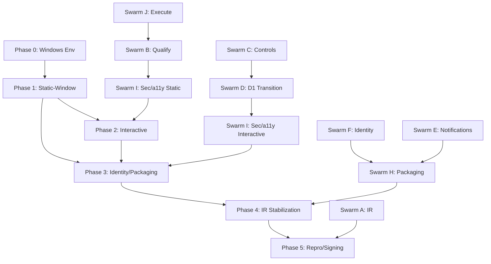

# Sash Roadmap to Completion — Swarm-Oriented

**Directive:** SASH-ENT-001  
**Programme Record:** SASH-ENT-002 (2026-11-15)  
**Current Integration Decision:** HOLD  
**Primary Blocker:** No Windows execution environment

---

## Phase Overview

| Phase | Theme | Target Decision | Key Unblock |
|-------|-------|-----------------|-------------|
| **0** | **Windows Execution Environment** | — | Acquire/access Windows x64, i686, ARM64 |
| **1** | **Static-Window Runtime Qualification** | PROMOTE `sash.win32.static-window/0.0.3` | Swarms J, B, I |
| **2** | **Interactive Runtime Qualification** | PROMOTE `sash.win32.interactive/0.0.2` | Swarms C, D, I |
| **3** | **Platform Identity & Packaging** | PROMOTE `portable-native` deployment | Swarms F, H, E |
| **4** | **IR Stabilization & Expansion** | PUBLISH SASH-WIN-IR/1 | Swarm A |
| **5** | **Reproducibility & Signing** | R1/R2 PASS, signed releases | Cross-worker infra |

---

## Phase 0 — Windows Execution Environment (Prerequisite)

**Owner:** Platform/Infra  
**Duration:** 1–2 weeks  
**Exit Criteria:** All three architectures launchable; clean-machine test protocol documented.

| Task | Architecture | Notes |
|------|--------------|-------|
| Provision Windows 11 x64 (physical or dedicated VM) | x86_64 | Primary qualification target. Must support PerMonitorV2, Narrator, high contrast. |
| Provision Windows 10/11 i686 (32-bit) | i686 | Can be VM on x64 host. Test `SetWindowLongW` path. |
| Provision Windows 11 ARM64 (physical) | aarch64 | **Physical ARM64 required** — emulation does not qualify. |
| Document clean-machine test protocol | All | Fresh install, no SDK, no dev tools. Capture import closure via `procmon` / `depends.exe`. |
| Automate artifact transfer + launch + log collection | All | Scripted: copy `App.exe`, run, capture stdout/stderr, exit code, ETW trace, accessibility tree. |

**Artifacts to launch (from SASH-ENT-002):**
- x64: `/tmp/sash-ent002/static-window/App.exe`, `/tmp/sash-ent002/interactive-cut/App.exe`
- i686: `/tmp/sash-stamp-i686/App.exe`, `/tmp/sash-stamp-ix86/App.exe`
- ARM64: `/tmp/sash-stamp-arm64/App.exe`, `/tmp/sash-stamp-iarm64/App.exe`

> **Note:** Pre-stamp i686/ARM64 images (embed `processorArchitecture="amd64"`) are rejected by `verify`. Use only the stamped images.

---

## Phase 1 — Static-Window Runtime Qualification

**Target:** `sash.win32.static-window/0.0.3` → **PROMOTE**  
**Swarms:** J (execution), B (qualification), I (security/a11y)  
**Dependency:** Phase 0 complete

### Swarm J — Execute Static-Window on Windows x64
**Package:** SASH-J02  
**Objective:** Launch the static-window binary on Windows x64 and record observed behavior.

| Step | Action | Evidence |
|------|--------|----------|
| J.1 | Launch `static-window/App.exe` on clean Windows x64 | Process starts, window appears, title = "hello" |
| J.2 | Verify window class = `SashStaticWindow` | `spy++` or `GetClassName` |
| J.3 | Verify `STATIC` controls placed at solved DIP rectangles | Visual match to `layout` output: root at (0,0,320,160) |
| J.4 | Verify system message font used (not default GUI font) | `WM_GETFONT` → `lfMessageFont` metrics |
| J.5 | Test DPI change (96 → 120 → 144 → 192) | Font recreates, controls reposition via `WM_DPICHANGED` |
| J.6 | Test cross-monitor move (if multi-monitor) | DPI awareness context updates, font recreates |
| J.7 | Close window → verify `UnregisterClassW` + font cleanup | Handle count returns to baseline |
| J.8 | Record exit code = 0 | `GetExitCodeProcess` |

**Exit Criteria:** All J.1–J.8 PASS on clean Windows x64.  
**Decision Gate:** If PASS → Swarm B proceeds. If FAIL → root cause, fix emission, re-link, repeat.

### Swarm B — Qualify Static-Window Runtime
**Package:** SASH-B01  
**Objective:** Convert observed behavior into admitted runtime claims.

| Claim | Test | Status Target |
|-------|------|---------------|
| Window creation | J.1–J.3 | PASS |
| Layout preservation | J.3 | PASS |
| System message font | J.4 | PASS |
| PerMonitorV2 DPI response | J.5–J.6 | PASS |
| Resource cleanup on close | J.7 | PASS |
| No CRT redistributable import | `depends.exe` on clean machine | PASS |
| Import closure = {KERNEL32, USER32, GDI32, ntdll, api-ms-win-core-synch-l1-2-0} | `depends.exe` | PASS |
| ASLR + DEP + CFG + high-entropy (x64) | `dumpbin /headers` | PASS |

**Deliverable:** `runtime-qualification: PASS` for `sash.win32.static-window/0.0.3` on x64.  
**Update:** `sash verify` exits 0 (not 3) for qualified x64 static-window images.

### Swarm I — Security & Accessibility Qualification
**Package:** SASH-I02  
**Objective:** Qualify security posture and accessibility of the launched static window.

| Area | Tests | Evidence |
|------|-------|----------|
| **Security** | | |
| ASLR/DEP/CFG verified | `dumpbin /headers`, `procdump` | DLL characteristics `0xc160` |
| No writable+executable pages | `!address` in WinDbg | PASS |
| Manifest `uiAccess="false"` | `mt.exe -inputresource:App.exe` | PASS |
| No unexpected imports | `depends.exe` | PASS |
| **Accessibility** | | |
| Narrator reads window title | Narrator + "hello" window | PASS |
| Narrator reads each `STATIC` label | Tab through labels | PASS |
| High contrast mode renders | Win+U → High Contrast | PASS |
| Keyboard focus order (Tab) | Tab through labels | PASS (static = no focus, but labels readable) |
| UIA `AutomationId` = semantic id | Inspect.exe / AccScope | **Gap** — not yet mapped |

**Decision Gate:** Security PASS required for PROMOTE. Accessibility gaps documented for Phase 3.

---

## Phase 2 — Interactive Runtime Qualification

**Target:** `sash.win32.interactive/0.0.2` → **PROMOTE**  
**Swarms:** C (controls), D (D1 transition), I (security/a11y)  
**Dependency:** Phase 1 PASS (shared runtime substrate)

### Swarm C — Native Buttons & Numeric Edit
**Package:** SASH-C01  
**Objective:** Qualify the interactive control set on Windows.

| Control | Tests | Evidence |
|---------|-------|----------|
| **EDIT** (numeric) | | |
| Accepts canonical integers only | Type "1", "−3", "00", "+1", "1.0" | Only canonical commits |
| Rejects non-canonical on commit | Enter on "00" → value unchanged | PASS |
| Copy/Cut/Paste policy enforced | Ctrl+C/V/X, Shift+Ins, Shift+Del | Per authored `gestures` block |
| `WM_COPY`/`WM_PASTE`/`WM_CUT` filtered | Spy++ message log | PASS |
| System clipboard integration | Copy → paste into Notepad | PASS when allowed |
| **BUTTON** (default) | | |
| Enter activates when focused | Focus button → Enter | `BM_CLICK` sent |
| Space activates when focused | Focus button → Space | PASS |
| Space to EDIT does not activate | Focus edit → Space → type space | PASS |
| Tab/Shift-Tab cycles EDIT ↔ BUTTON | Tab order | PASS |
| **Result STATIC** (`state.count`) | | |
| Displays canonical decimal | Initial "0", after add "3" | PASS |
| Readback verification | Written text ≠ parsed → revert | PASS |

**Exit Criteria:** All control behaviors match `interactive.rs` specification on Windows x64.

### Swarm D — Checked D1 Transition with Rollback
**Package:** SASH-D02  
**Objective:** Qualify the state transition semantics under all edge cases.

| Scenario | Expected | Test |
|----------|----------|------|
| Valid addition (1 + 2 = 3) | Commit, revision+1, result shows 3 | PASS |
| Overflow (`i64::MAX` + 1) | Revert, revision unchanged, result shows previous | PASS |
| Non-canonical edit ("00") | Revert, revision unchanged | PASS |
| Result text readback mismatch | Revert, revision unchanged, result restored | PASS |
| Nested activation (Enter during write) | Ignored, no double-commit | PASS |
| Release during write (`RELEASED` flag) | Drop commit, no store | PASS |
| Failed `SetWindowTextW` | Revert, revision unchanged | PASS |
| Revision overflow (`u64::MAX`) | Revert | PASS |

**Automation:** Script via UI Automation or Win32 `SendMessage`/`PostMessage` to drive all scenarios headlessly.

**Exit Criteria:** All 8 scenarios PASS on Windows x64.  
**Decision Gate:** Swarm I re-runs security/a11y on interactive image.

### Swarm I (Interactive) — Security & Accessibility
**Same package SASH-I02, extended scope.**

| Additional Tests | Evidence |
|------------------|----------|
| EDIT subclass filter blocks denied operations | `WM_PASTE` denied → text unchanged |
| `Shift+Delete` blocked when cut denied | Spy++ shows message dropped |
| `Delete` (no Shift) still works | Text deletes locally |
| Focus management (EDIT ↔ BUTTON) | Narrator announces focus changes |
| EDIT accessible name = semantic id | Inspect.exe shows `window.amount` |
| Result label accessible name = `state.count` | Inspect.exe shows `state.count` |

---

## Phase 3 — Platform Identity & Packaging

**Target:** `portable-native` deployment profile → **PROMOTE**  
**Swarms:** F (identity), H (packaging), E (notifications)  
**Dependency:** Phase 2 PASS

### Swarm F — Canonical Windows Application Identity
**Package:** SASH-F01  
**Objective:** Establish shell identity for installed and portable modes.

| Deliverable | Specification |
|-------------|---------------|
| **AppUserModelID** | `ELCI.Goya.Sash.StaticWindow` / `...InteractiveWindow` |
| **Version resource** | `FileVersion` = profile version (e.g., `0.0.3.0`), `ProductVersion` = same |
| **Manifest** | `asInvoker`, `uiAccess="false"`, `PerMonitorV2`, `supportedOS` GUIDs for Win10/11 |
| **Shortcut** | Start Menu + Desktop (installed mode), none (portable) |
| **Jump List** | Recent scenes (future), pinned (future) |
| **Taskbar progress** | Not in static/interactive profiles |

**Exit Criteria:** `AppUserModelID` registered, taskbar groups correctly, shortcuts created by installer.

### Swarm H — Portable-Native Packaging Qualification
**Package:** SASH-H01  
**Objective:** Define and qualify the `portable-native` deployment unit.

| Artifact | Contents |
|----------|----------|
| `App.exe` | Signed (Phase 5), PE32/PE32+ per arch |
| `App.pdb` | Private symbols (optional, separate download) |
| `build-report.json` | SHA-256s, PE info, reproducibility claim |
| `evidence/` | Generated source map, dispositions, import closure |
| `README.txt` | Launch instructions, no-install notice |

**Tests:**
- Extract ZIP → run `App.exe` → works (portable)
- No registry writes, no `%APPDATA%` writes (static/interactive profiles)
- Clean removal = delete directory

### Swarm E — Canonical Windows Notification API
**Package:** SASH-E02  
**Objective:** Lock one notification API for future profiles (S3-CARDS gap).

| Candidate | Evaluation |
|-----------|------------|
| **Toast Notifications (WinRT)** | Requires `AppUserModelID`, package identity. Modern, supports actions. |
| **Shell_NotifyIcon (tray)** | Legacy, no action buttons. Fallback only. |
| **WinUI 3 Toast** | Requires Windows App SDK dependency. Heavy. |

**Decision:** **Toast Notifications (WinRT)** — native, no extra runtime, supports `AppUserModelID` from Swarm F.  
**Deliverable:** ADR documenting choice, minimal prototype sending one toast on button click (new profile gate).

---

## Phase 4 — IR Stabilization & Expansion

**Target:** Publish **SASH-WIN-IR/1** as stable contract  
**Swarm:** A  
**Dependency:** Phase 3 PASS (identity + packaging known)

### Swarm A — Versioned SASH-WIN-IR/1
**Package:** SASH-A02  
**Objective:** Replace ad-hoc emission with a versioned IR that separates admission from codegen.

| Milestone | Deliverable |
|-----------|-------------|
| A.1 | Define `sash_win_ir::v1` schema: `Window`, `Control`, `Layout`, `Transition`, `GesturePolicy`, `Identity`, `Resources` |
| A.2 | Refactor `emit.rs` + `interactive.rs` → `lower_to_ir(Admitted) → IR` → `codegen(IR) → Generated` |
| A.3 | Add IR round-trip test: `admit → lower → codegen → admit(IR)` = identical dispositions |
| A.4 | Publish `SASH-WIN-IR/1` contract document (like `GSSH/1`) |
| A.5 | Admit new profile `sash.win32.static-window/0.1.0` targeting IR v1 (bump only for IR version) |

**Why now?** Phase 1–3 prove the runtime. IR stabilization enables:
- Multiple backends (Win32 today, WinUI future, AOT WASM future)
- Cross-compiler tooling (linter, diff, migration)
- Profile evolution without breaking emission

---

## Phase 5 — Reproducibility & Signing

**Target:** R1/R2 PASS, signed releases  
**Dependency:** Phase 4 (IR stable), independent worker infrastructure

| Gate | Requirement | Infrastructure |
|------|-------------|----------------|
| **R1** (same host, clean) | Two clean builds on same machine = identical bytes | Fresh VM / container per build |
| **R2** (independent workers) | Two different machines = identical bytes | GitHub Actions (ubuntu-latest) + self-hosted Linux runner, or two cloud VMs |
| **Signing** | Authenticode + timestamp | Code signing cert (EV or standard), `signtool` / `osslsigncode` |
| **SmartScreen** | Reputation established | Submit to Microsoft, monitor |

**Note:** Current single-host reproducibility (52 PASS in SASH-ENT-002) satisfies neither R1 nor R2. Two *independent* workers required.

---

## Swarm Dependency Graph

---

## Milestone Calendar (Target Dates)

| Milestone | Target | Criteria |
|-----------|--------|----------|
| **M0** Windows env ready | Week 2 | 3 architectures launchable |
| **M1** Static-window x64 PASS | Week 4 | Swarms J, B, I complete |
| **M2** Static-window i686/ARM64 PASS | Week 6 | Cross-arch qualification |
| **M3** Interactive x64 PASS | Week 8 | Swarms C, D, I complete |
| **M4** Interactive i686/ARM64 PASS | Week 10 | Cross-arch qualification |
| **M5** Portable-native packaged | Week 12 | Swarms F, H, E complete |
| **M6** SASH-WIN-IR/1 published | Week 14 | Swarm A complete |
| **M7** R1/R2 PASS + signed | Week 18 | Phase 5 complete |
| **M8** **RELEASE ADMISSION** | Week 20 | All profiles PROMOTE, `release_admission: PASS` |

---

## Resource Requirements

| Resource | Phase | Notes |
|----------|-------|-------|
| Windows 11 x64 (physical/VM) | 0–5 | Primary qualification target |
| Windows 10/11 i686 (VM) | 0–5 | 32-bit test |
| Windows 11 ARM64 (physical) | 0–5 | **Must be physical** — emulation invalid |
| Clean-machine test harness | 0 | Scripted launch + log capture |
| Code signing certificate | 5 | EV preferred for SmartScreen |
| Two independent Linux builders | 5 | For R2 (GitHub Actions + self-hosted) |
| Narrator/high-contrast test time | 1–2 | Accessibility qualification |

---

## Risk Register

| Risk | Likelihood | Impact | Mitigation |
|------|------------|--------|------------|
| No ARM64 hardware access | High | Blocks ARM64 qualification | Partner with ARM/cloud provider; document as known limitation for v1 |
| DPI/font rendering differs from layout | Medium | Layout disposition "preserved" falsified | Test early (Phase 0); adjust `MP_PER_DIP` or admission if systematic |
| Gesture filter misses edge cases | Medium | Security/a11y failure | Fuzz test `WM_*` messages; log all filtered messages |
| `cargo-xwin` / `llvm-rc` version drift | Low | Build breakage | Pin versions in `toolchain` manifest; vendor if needed |
| SmartScreen blocks unsigned | High (pre-signing) | Portable distribution fails | Sign early (Phase 5); submit for reputation |
| IR design requires emission rewrite | Medium | Schedule slip Phase 4 | Incremental: IR as intermediate, keep current emission as v0 backend |

---

## Definition of Done (Per Profile)

A profile `sash.win32.<name>/<version>` is **PROMOTE**d when:

1. ✅ `cargo test -p sash --offline --lib` PASS
2. ✅ `sash check` admits fixture scenes for all 3 triples
3. ✅ `sash build` links for all 3 triples (PE policy PASS)
4. ✅ `sash verify` exits 0 (PE PASS + runtime/release PASS) on **all 3 arches**
5. ✅ Clean-machine launch PASS on **all 3 arches** (Phases 1–2)
6. ✅ Security qualification PASS (Swarm I)
7. ✅ Accessibility baseline PASS (Narrator, high contrast, keyboard)
8. ✅ Portable-native package produced (Phase 3)
9. ✅ R1 PASS (same host, clean)
10. ✅ R2 PASS (independent workers)
11. ✅ Signed + timestamped
12. ✅ `release_admission: PASS` in build report

---

## Current Status → Next Action

| Swarm | Status | Next Action |
|-------|--------|-------------|
| G | PASS | Maintain |
| **J** | **BLOCKED** (smoke tier available: the `windows-smoke` CI job launches the x64 images on windows-latest; not qualification) | **Acquire Windows x64 machine (Phase 0)** |
| B | HOLD | Wait for J |
| C | PASS (build) | Wait for J |
| D | PASS (build) | Wait for J |
| I | HOLD | Wait for J |
| F | NOT_STARTED | Wait for Phase 2 |
| H | NOT_STARTED | Wait for Phase 2 |
| E | NOT_STARTED | Wait for Phase 2 |
| A | **COMPLETE** (except A.5, gated on Phase 3) | SASH-WIN-IR/1 Candidate published; both profiles emit through the IR; ten recorded links reproduce byte-for-byte |

**Completed since the roadmap was written (2026-11-18):**
- Swarm A: `crates/sash-ir` + lowering + codegen for both profiles, wired as the
  only emission path, byte-exact against the adopted emitters, contract
  published (`docs/sash/SASH-WIN-IR-1.md`, `docs/contracts.md`).
- Cross-architecture end-to-end reproduction: x64, i686, and ARM64 links of
  both fixtures reproduce the recorded SASH-ENT-002 hashes; `sash verify`
  exits 3 with the correct machine and profile on all six images. The gate is
  permanent: `cargo test -p sash --offline --test link_reproduction -- --ignored`.
- Windows API floors: `--api-floor win10|win8` admits a system-DPI-aware
  legacy adapter (no Windows 10 1703+ per-monitor imports) under the
  `-legacy` presentation profiles for i686 and x64; win7/vista/xp are refused
  with the toolchain reason, and win8 x ARM64 is refused as meaningless.
- Phase 0 harness anti-drift: `sash expectations` projects the IR into the
  runtime-contract JSON the launch harness consumes; the harness refuses to
  run against hand-maintained tables.
- Windows smoke tier: `windows-smoke` CI job launches the x64 images on
  `windows-latest` with compiler-generated expectations. Informational only.

**Immediate Next Step:** Execute **Phase 0** — provision Windows execution environment. All downstream swarms are gated on this.

---

## Appendix: Swarm Roster Template

| Swarm | Package | Lead | Engineers | Target Date | Status |
|-------|---------|------|-----------|-------------|--------|
| G | SASH-G01 | — | — | — | PASS |
| J | SASH-J02 | TBD | TBD | Week 4 | BLOCKED |
| B | SASH-B01 | TBD | TBD | Week 4 | HOLD |
| I | SASH-I02 | TBD | TBD | Week 4 | HOLD |
| C | SASH-C01 | TBD | TBD | Week 8 | HOLD |
| D | SASH-D02 | TBD | TBD | Week 8 | HOLD |
| F | SASH-F01 | TBD | TBD | Week 12 | NOT_STARTED |
| H | SASH-H01 | TBD | TBD | Week 12 | NOT_STARTED |
| E | SASH-E02 | TBD | TBD | Week 12 | NOT_STARTED |
| A | SASH-A02 | TBD | TBD | Week 14 | NOT_STARTED |

*Assign leads and engineers once Phase 0 is funded.*